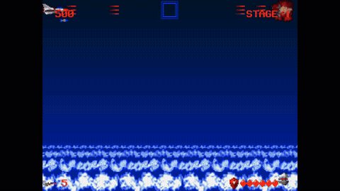

# Fox Ranger (폭스레인저, 1992) — Native Recompilation & English Translation

A native, portable C static recompilation and full English translation of **Fox Ranger (폭스레인저)**, the legendary 1992 vertical scrolling shoot'em up for MS-DOS developed by Soft Action.

<p align="center">
  
</p>

---

## Highlights & Features

- **Native Multiplatform Performance**: 100% decompiled and statically recompiled into clean C99 code running natively at full 60 FPS on macOS (Apple Silicon & Intel), Linux, and Windows.
- **Zero-Copyright Asset Ingestion**: The repository and distributed binaries contain **zero copyrighted assets**. On first boot, the retro Mission Control launcher prompts the user to select their original 1992 DOS floppy files or `FOX.EXE`.
- **1992 Mission Control Launcher**: Authentically themed 640×480 VGA cockpit launcher with starfield animation, native file/folder pickers, and live asset status indicators.
- **Independent 4-Channel Audio Mixer**: Real-time volume sliders for **Master**, **BGM (Music)**, **SFX (Sound Effects)**, and **Voice (Speech)**.
- **Authentic FM & Speech Synthesis**:
  - Integrated cycle-accurate **Nuked-OPL3** Yamaha YMF262 FM emulator.
  - Authentic Creative Labs **CT-VOICE** digitized speech PCM playback (`VOICE.DAT`).
  - Restored hybrid PC-Speaker and FM sound effects.
- **Arranged CD Soundtrack Streaming**: Place modern high-fidelity `.ogg` or `.wav` soundtrack arrangements into `enhanced_music/`. The engine seamlessly streams and loops them with automatic fallback to OPL3 FM synthesis for missing tracks.
- **Roland MT-32 & SC-55 Support**: Ingests and plays original Roland MIDI music banks if `MT32.DAT` or `SC55.DAT` are present.
- **Complete English Translation**: Full localization of the prologue story, HUD text, boss dialogues, endings, and staff credits with seamless Korean/English language switching.
- **Modern Quality-of-Life**:
  - CRT 4:3 aspect ratio correction with integer/smooth scaling.
  - Rapid autofire (18 shots/second) mapped to `D` / `Ctrl` / Gamepad Button A.
  - Shield cheat engine and classic Konami code support (`Up Up Down Down Left Right Left Right B A`).

---

## Game Ingestion & Required Files

To play, you must provide the original game data files from a legitimate copy of Fox Ranger (1992 DOS):

| File | Purpose |
| :--- | :--- |
| `FOX.DAT` | Korean & system fonts, HUD graphics, title logos, cutscene frames |
| `ADLIB.DAT` | Authentic AdLib / Sound Blaster FM instruments and BGM sequences |
| `VOICE.DAT` | Digitized Sound Blaster speech clips (CT-VOICE) |
| `STAGE.DAT` | Stage tilemaps, collision data, and level progression |
| `VSPRITE.PAT` | Sprite sheets for Fox Ranger ship, enemy craft, bosses, and explosions |
| `FOX.EXE` | Original DOS executable (unpacked automatically at runtime) |

Optional audio enhancements:
- `MT32.DAT` — Roland MT-32 MIDI soundtrack bank.
- `SC55.DAT` — Roland Sound Canvas SC-55 General MIDI bank.
- `enhanced_music/*.ogg` — Modern arranged CD audio tracks.

---

## Controls

| Action | Keyboard Primary | Keyboard Alternate | Gamepad (SDL2) |
| :--- | :--- | :--- | :--- |
| **Steer Fox Ranger** | `Arrow Keys` | `W` / `A` / `S` / `D` | D-Pad / Left Analog Stick |
| **Primary Fire / Rapid Fire** | `D` | `Left Ctrl` | Button A (South) |
| **Secondary Weapon (Special)** | `C` | `Left Alt` | Button B (East) |
| **Menu Confirm** | `Enter` / `Space` | | Button Start / A |
| **Pause / Menu** | `Esc` | | Button Back / Guide |

*Note: The secondary weapon activates once you collect secondary weapon upgrade modules during a stage!*

---

## Building from Source

### Prerequisites
- **CMake** >= 3.16
- **C99-compatible Compiler** (Clang, GCC, or MSVC)
- **SDL2** (Headers and runtime library)
- **Python 3** (Optional, required only for running differential test suites)

### macOS
```bash
brew install cmake sdl2
cmake -B build -DCMAKE_BUILD_TYPE=Release
cmake --build build --config Release
```

### Linux (Debian / Ubuntu)
```bash
sudo apt-get update && sudo apt-get install -y build-essential cmake libsdl2-dev
cmake -B build -DCMAKE_BUILD_TYPE=Release
cmake --build build --config Release
```

### Windows (Visual Studio / MinGW)
```powershell
cmake -B build -DCMAKE_BUILD_TYPE=Release
cmake --build build --config Release
```

---

## Running the Automated Test Suite

The project includes an end-to-end automated verification harness with 100% function parity validation:

```bash
ctest --test-dir build --output-on-failure
```

Test coverage includes:
- `audio_sfx_opl`: Validates FM synthesis, CT-VOICE speech decoding, and OPL3 test tones.
- `boot_title_stage1`: Headless boot smoke test verifying intro, title, and stage 1 startup.
- `diff_blit_10a7`: 500 randomized trials of Mode-X 4-plane VGA bit-blit against hardware reference.
- `diff_fn_game`: Multi-trial differential execution against Unicorn x86 CPU emulator across all 9 game modules.
- `diff_crt_shims`: 600 randomized trials verifying C runtime shims against MS-DOS Borland C++ CRT.

---

## Packaging for Release

Generate standalone multiplatform packages locally with:

```bash
bash tools/package_release.sh
```

Or trigger the automated GitHub Actions workflow (`.github/workflows/release.yml`) by pushing a version tag:
```bash
git tag v1.0.0
git push origin v1.0.0
```

---

## Technical Documentation & Architecture Report

For a complete engineering retrospective, reverse-engineering ledger, and architecture deep-dive covering memory mapping, Mode-X planar VGA simulation, sound hardware, and the differential verification methodology:

📖 **Read the Full Technical Report**: [`PROJECT_REPORT.md`](PROJECT_REPORT.md)

---

## Third-Party Licenses

- **Nuked-OPL3**: LGPL-2.1-or-later (see `third_party/nuked-opl3/LICENSE`).
- **stb_vorbis**: Public Domain / MIT license (see `third_party/stb_vorbis/stb_vorbis.c`).
- **Fox Ranger Recompilation**: MIT License. Original game code and assets &copy; 1992 Soft Action.
